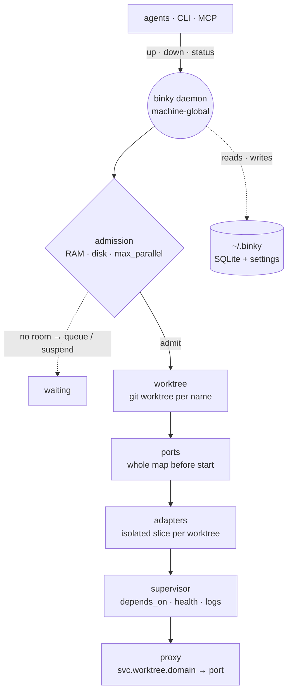

<div align="center">


# Binky

**One isolated local world per git worktree — ports, env, database, URLs.**

So a swarm of coding agents runs in parallel on one machine without anything colliding.

[](https://github.com/andreisilva1/binky/actions/workflows/ci.yml)
[](https://pypi.org/project/binky/)
[](pyproject.toml)
[](LICENSE)

[Quickstart](#quickstart) · [Adapters](#adapters) · [Commands](#commands) · [For agents](#for-agents) · [How it works](#how-it-works) · [Troubleshooting](TROUBLESHOOTING.md)

</div>

---

`docker-compose` was built for one process at a time. Binky is built for fifteen at once.

> **Status: alpha.** The core works end to end — worktree isolation, ports, adapters, supervision,
> reconciler, admission, proxy, HTTPS. The config format is stable; the CLI may still move.

## The problem

You point three agents at the same repo. The second one runs `pnpm dev` and gets `EADDRINUSE`.
The third runs your migrations and drops the table the first was reading. You start hand-editing
`.env` files, and now you're the scheduler.

Binky is the scheduler. One `binky up <branch>` per agent, and each gets its own ports, its own
database, its own URLs — from the same committed config.

## Install

Python 3.11+ and git, on **Linux or Windows** — the two platforms Binky is tested on for real.
macOS isn't a supported target yet; a well-tested port would be a welcome [contribution](CONTRIBUTING.md).

```bash
uv tool install binky          # or: pipx install binky
binky --version
```

Or from a clone, to run the unreleased `main` or to hack on it:

```bash
git clone https://github.com/andreisilva1/binky && cd binky
uv tool install .               # or: pipx install .
```

Adapters that need a driver ship as extras — installing Binky for Redis shouldn't pull `boto3`:

```bash
uv tool install "binky[postgres]"        # or [redis], [mysql], [mongodb], [s3], [kafka]
uv tool install "binky[all-adapters]"    # the whole matrix
```

## Quickstart

Already have a `docker-compose.yml`? Start from it:

```bash
binky init                 # writes a binky.toml you can read and edit
binky check                # validate it
```

Or write it by hand — this is the whole config:

```toml
[project]
name = "acme"

[services.web]
cmd = "pnpm dev --port ${self.port}"
url = "web"                              # → web.<worktree>.acme.localhost
depends_on = ["api"]
env = { API_URL = "${api.url}" }

[services.api]
cmd = "go run ./cmd/server"
url = "api"                              # asking for a URL is what asks for a port
depends_on = ["db"]
env = { DATABASE_URL = "${db.url}" }

[services.db]
adapter = "postgres"                     # a private database per worktree
admin_url = "${env.POSTGRES_ADMIN_URL}"
migrate = "make migrate"
seed = "make seed"
clone_from = "golden"                    # migrate+seed once, then copy per worktree
```

Then bring worktrees up in parallel:

```console
$ binky up login-fix
  api  pid 16560  :4846
  web  pid 29732  :4504
✓ up: login-fix (2 service(s))

$ binky up checkout-v2
  api  pid 21768  :4137
  web  pid 46336  :4605
✓ up: checkout-v2 (2 service(s))

$ binky status
acme
  checkout-v2  [running]
      api  :4137
      web  :4605
  login-fix  [running]
      api  :4846
      web  :4504
```

Two branches, four processes, four ports nobody chose by hand. Hand a worktree's coordinates to
whoever needs them — a shell, an agent, a test run:

```console
$ binky env login-fix --dotenv
WEB_URL=http://web.login-fix.acme.localhost
API_URL=http://api.login-fix.acme.localhost
```

And the rest of the lifecycle:

```bash
binky down login-fix       # pause (keeps files + ports); `up` again is instant
binky remove login-fix     # destroy it (refuses if there are uncommitted changes)
```

Nothing is hardcoded and nothing is discovered at runtime: every process boots already knowing the
whole port map, its own and its dependencies'.

> **One rule to internalise.** A service gets a port when it declares `url` or `ports` — asking is
> explicit. A service with neither gets none, which is correct for a worker or a one-shot job, and a
> trap if you then write `${self.port}` in its `cmd`. Unknown tokens are left alone rather than
> blanked, so the literal `${self.port}` reaches the shell and the process dies on its own argument
> parsing. `binky check` warns when a service does this.

## What it costs to run N worlds

The claim is that N isolated worlds shouldn't cost N times one world. Measured, not asserted —
`benchmarks/worlds.py` is in this repo and reproduces the table below (`postgres:16`, 200,000 rows
per world, Docker Desktop on Windows 11):

| worlds | RAM: a container each | RAM: Binky | time: a container each | time: Binky |
| ---: | ---: | ---: | ---: | ---: |
| 1 | 150 MiB | 174 MiB | 6s | 4s |
| 2 | 298 MiB | 182 MiB | 11s | 6s |
| 4 | 596 MiB | 228 MiB | 20s | 10s |
| 8 | 1197 MiB | 295 MiB | 40s | 16s |

**The 8th world costs +150 MiB and +4.8s as its own container, or +17 MiB and +1.7s under Binky.**

Read the first row too. At **one** world Binky is behind — it pays for a server plus a golden
template nobody is using yet, and only earns that back on the second. And **disk is not a win**:
`CREATE DATABASE ... TEMPLATE` is a file copy, not copy-on-write, so every world is still a full
copy of the rows. What Binky removes is the *server* per world, not the *bytes* per world. It also
doesn't make your own app processes cheaper — one dev server per worktree costs the same either way.

```bash
python benchmarks/worlds.py --sweep 1,2,4,8 --rows 200000
```

## When you don't need Binky

Worth saying plainly, because the first row of that table already says it:

- **One branch at a time.** If you never have two worlds up at once, Binky is a daemon and a config
  file you didn't need. Use it when the second agent shows up.
- **Everything already runs in containers, and that's fine.** Binky's win is removing the *server*
  per world. If your compose stack is small enough that N copies fit comfortably, there's nothing
  to reclaim.
- **You need real isolation, not local isolation.** Binky runs your commands as you, on your
  machine. It is not a sandbox — see [Security](#security).

## Adapters

An adapter carves an isolated **slice** of one shared server — a database, a key prefix, a bucket —
instead of running one server per worktree. **16 names, 10 implementations, every one exercised
against a real server in CI.**

| slice | adapters |
| --- | --- |
| a database | `postgres` · `mysql` · `mariadb` · `percona` · `mongodb` · `clickhouse` |
| a key prefix | `redis` · `valkey` |
| a bucket / prefix | `s3` · `minio` |
| a vhost / topic prefix | `rabbitmq` · `kafka` · `redpanda` |
| a collection | `qdrant` |
| an index prefix | `elasticsearch` · `opensearch` |

Protocol-compatible names share one implementation rather than a copy of it — `valkey` is the Redis
adapter, `percona` is the MySQL one, `opensearch` is the Elasticsearch one.

### `clone_from`: pay for migrate+seed once

With `clone_from`, the first `binky up` builds a **golden template** — provision, migrate, seed —
and every worktree after that is a copy of it. The template is keyed by a hash of your `migrate` and
`seed` commands, so changing either rebuilds it automatically.

Supported where the server can copy a slice server-side (`postgres`, `mysql`, `mariadb`, `percona`,
`mongodb`). Where it isn't, or where a clone fails on something environmental — a client binary too
old to authenticate, a missing grant — Binky **falls back** to provision+migrate+seed for that
worktree and logs `clone_fallback`. Correctness never depends on cloning; only speed does.

One sharp edge worth knowing: the hash covers the migrate and seed *commands*, not the files they
call. Editing a script those commands run does not rebuild the template — delete its marker under
`~/.binky/golden/` to force one.

### Writing your own

Two tiers, one contract. Both implement the same four verbs:

| verb | does |
| --- | --- |
| `provision(slice)` | create the slice (`CREATE DATABASE ...`) |
| `resolve(slice)` | return its address → `${db.url}` |
| `teardown(slice)` | destroy it |
| `capabilities()` | what it supports, e.g. `{"clone": true}` |

**In-process** adapters are Python classes in this repo, discovered by name. **External** adapters
are executables in any language, discovered as `binky-adapter-<name>` on `PATH` and driven over a
one-shot subprocess + JSON protocol:

```console
$ binky-adapter-filestore provision   <<< '{"slice": "acme_login-fix", "config": {}}'
{"ok": true}
$ binky-adapter-filestore resolve     <<< '{"slice": "acme_login-fix", "config": {}}'
{"ok": true, "address": "file:///tmp/binky-filestore/acme_login-fix"}
```

Python authors get the protocol for free — `binky.adapter_sdk.run()` bridges a normal adapter class
to it. See [examples/adapters/filestore.py](examples/adapters/filestore.py) for a complete,
dependency-free one in 30 lines.

## Commands

| Command | What it does |
|---|---|
| `binky init [dir] [--force]` | Write a starting `binky.toml` from `docker-compose.yml` + `.env` |
| `binky check [path]` | Validate a `binky.toml` and flag footguns |
| `binky up <name> [--group g]` | Create/use the branch's worktree, allocate ports, provision resources, start services |
| `binky reload <name> [--group g]` | Restart in place — stop, then bring back up on the same ports and data |
| `binky down <name>` | Stop the worktree's processes (keeps its files and ports) |
| `binky remove <name> [--force]` | Destroy the worktree — stop, drop its slices, remove its files |
| `binky status [.]` | List worktrees (grouped by project); `.` = current project only |
| `binky env <name> [--dotenv]` | Print a worktree's exposed coordinates, for you or an agent |
| `binky curl <name> <service> [path]` | Call a service through the proxy with the `Host` header filled in (`-X`/`-d`/`-H`/`-i`/`-f`) |
| `binky verify <name>` | Run the project's `agents.verify` checks; exits non-zero on failure |
| `binky logs <name>` | Print a worktree's captured service logs |
| `binky gc` | Sweep orphaned adapter slices a crash left half-provisioned |
| `binky config` | Show the machine-global settings (RAM/disk reserves, proxy ports) |
| `binky reserve [--ram %] [--disk gb]` | Set how much RAM/disk Binky permanently keeps free |
| `binky port [--proxy p] [--https p]` | Set the proxy/HTTPS ports |
| `binky dashboard` | Live TUI of every worktree |
| `binky doctor` | Diagnose the install and daemon; exits non-zero if something is wrong |
| `binky metrics` | Point-in-time daemon metrics as JSON |
| `binky mcp` | Run the MCP server so agents can call Binky's verbs as tools |
| `binky daemon start\|stop\|status` | Manage the background daemon |

## For agents

`binky mcp` speaks MCP over stdio, exposing `up`, `down`, `status`, `env` and `verify` — the same
verbs the CLI calls, against the same daemon.

In Claude Code, one line wires it up:

```bash
claude mcp add binky -- binky mcp
```

Any other client that speaks the protocol takes the same stdio server as a config block — the same
one everywhere, only the file differs:

```json
{ "mcpServers": { "binky": { "command": "binky", "args": ["mcp"] } } }
```

To run it with nothing installed, hand it to `uvx` instead — `claude mcp add binky -- uvx --from
"binky[all-adapters]" binky mcp`, or as a block, `"command": "uvx"`, `"args": ["--from",
"binky[all-adapters]", "binky", "mcp"]`.

## How it works

A single machine-global daemon sits between your worktrees and the machine:



1. **Worktree** — creates/uses a git worktree per name.
2. **Ports** — a global allocator assigns every process a port *before anything starts* and injects
   the whole map, so nothing collides (`${self.port}`, `${api.url}`, …).
3. **Resources** — adapters carve an isolated slice per worktree and tear it down on remove.
4. **Supervision** — starts services in `depends_on` order, waits for health, captures logs.
5. **Proxy** — routes `<service>.<worktree>.<domain>` to the right port (WebSockets/HMR included).
   Set `https = true` and Binky fronts it with Caddy for TLS via a local CA, when Caddy is on PATH.
6. **Admission** — a FIFO queue that only starts a worktree when the machine has room: fewer than
   `max_parallel` running **and** enough free RAM (a percentage kept in reserve) **and** enough free
   disk (a fixed GB headroom). If a running swarm later crosses the RAM reserve, the daemon suspends
   the newest worktree to relieve pressure and resumes it — in fairness order — once room returns.
   Tune the reserves with `binky reserve`; see them with `binky config`.

State lives in `~/.binky/` (a SQLite registry plus a settings store, migrated in place across
upgrades). Nothing runs in the cloud, and Binky never phones home.

## Examples

- [examples/hello](examples/hello) — the smallest possible project.
- [examples/rag](examples/rag) — vector search where each worktree gets its own embedded corpus.
  The case where sharing a database actually hurts: two agents re-indexing, one `TRUNCATE`.
- [examples/adapters/filestore.py](examples/adapters/filestore.py) — an external adapter, complete.

## Security

Binky runs **your** commands on **your** machine as **you**. It is a developer tool for a
single-user workstation, not a multi-tenant sandbox — a `binky.toml` is as trusted as a `Makefile`,
and `binky up` on a repo you don't trust is `make` on a repo you don't trust. The threat model and
what's explicitly out of scope are written down in [SECURITY.md](SECURITY.md).

The one rule worth repeating here: **never put a credential inline in a committed `binky.toml`**.
Use `${env.NAME}` or an `env_file`. `binky check` warns when you do, and `binky init` never writes
one.

## Something not working?

[TROUBLESHOOTING.md](TROUBLESHOOTING.md) covers the cases that actually come up — a port held from
outside, a dev server ignoring `$PORT`, a stale golden template, `*.localhost` not resolving. Start
with `binky doctor`.

## Development

```bash
python -m venv .venv && . .venv/bin/activate   # or .venv\Scripts\activate on Windows
pip install -e ".[dev,all-adapters]"
pytest
ruff check src tests examples benchmarks
```

Adapter integration tests skip unless you point them at a real server —
`BINKY_TEST_PG`, `BINKY_TEST_REDIS`, `BINKY_TEST_MYSQL`, `BINKY_TEST_MONGO`, `BINKY_TEST_S3`,
`BINKY_TEST_RABBITMQ`, `BINKY_TEST_KAFKA`, `BINKY_TEST_QDRANT`, `BINKY_TEST_CLICKHOUSE`,
`BINKY_TEST_ELASTICSEARCH`. CI provides all of them.

## Contributing

Bug reports, new adapters, and PRs are welcome — see [CONTRIBUTING.md](CONTRIBUTING.md) to
get set up, and [ARCHITECTURE.md](ARCHITECTURE.md) for a map of the internals.

## License

Apache-2.0 — see [LICENSE](LICENSE) and [NOTICE](NOTICE).
